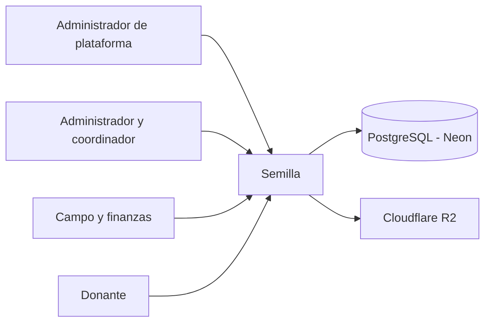
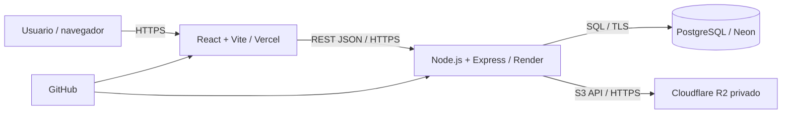
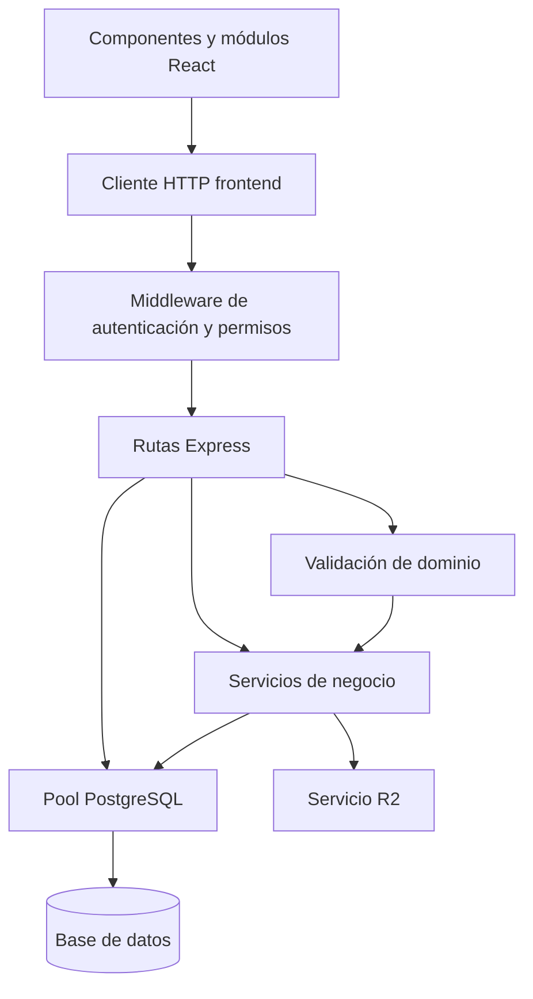
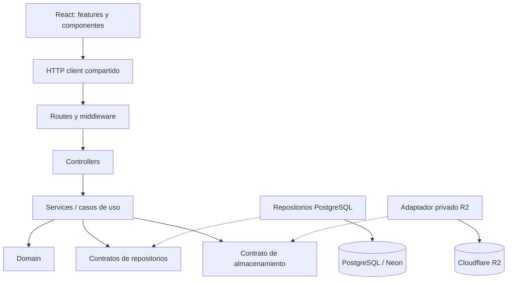
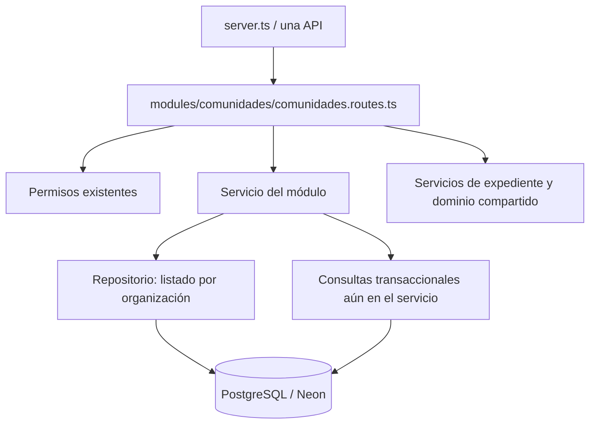
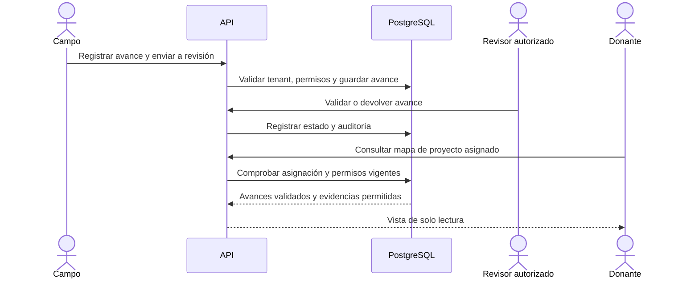

# Arquitectura de Semilla

**Proyecto:** Semilla — Recursos que generan desarrollo  
**Versión de referencia:** Semana 6, 21 de noviembre de 2026.

**Estándar arquitectónico vigente:** [ADR-006 — Arquitectura modular por capas](decisiones/006-arquitectura-modular-por-capas.md), aceptada el 23 de noviembre de 2026. Este documento distingue la estructura actual del objetivo progresivo; la aprobación del estándar no implica migración completa.

## 1. Contexto y alcance

Semilla centraliza la gestión de programas de desarrollo comunitario. La solución relaciona organizaciones, comunidades, familias, proyectos, recursos, donantes y evidencias. El sistema permite que cada organización gestione su propia información y que los donantes consulten únicamente los proyectos autorizados.

Los actores principales son el administrador de plataforma, administrador institucional, coordinador, personal de campo, finanzas y donantes. Los permisos efectivos determinan qué operaciones puede realizar cada cuenta.



## 2. Contenedores y despliegue

Se utiliza un monolito modular en el backend, con frontend independiente y servicios administrados de persistencia. No se requiere desplegar un microservicio por módulo.



| Contenedor | Responsabilidad |
|---|---|
| Frontend | Interfaz React y TypeScript, estilos CSS, navegación por roles, formularios y consumo de API. |
| Backend | Express y TypeScript; autenticación, autorización, reglas de negocio, validaciones y acceso a datos. |
| PostgreSQL | Modelo relacional, restricciones, transacciones y auditoría. Neon separa desarrollo y producción. |
| Cloudflare R2 | Conservación privada de evidencias y acceso controlado desde el backend. |

La configuración de conexiones y credenciales se mantiene en variables de entorno. No se incluyen secretos en el repositorio ni en los diagramas.

## 3. Componentes y capas



La organización actual separa presentación, comunicación HTTP, autorización, dominio y servicios. La modularización es incremental: comunidades agrupa sus rutas y servicio, y extrae su consulta de listado a un repositorio. Las reglas de dominio de metas y necesidades, así como los servicios de capacidades y necesidades, ahora también se agrupan en el módulo, conservando adaptadores de importación para sus consumidores anteriores. Otras operaciones de comunidades y otras rutas todavía contienen SQL en servicios o controladores; por tanto, aún no existe una capa de repositorios uniforme. Se utiliza el controlador pg para las consultas de negocio y se mantienen dependencias y utilidades de Prisma. Los cambios del esquema se versionan en scripts SQL.

### Estructura objetivo y dependencias (ADR-006)

La representación anterior describe la implementación histórica y sus dependencias directas al pool. **No es el flujo objetivo.** La estructura de destino aprobada es:



Las rutas no deben contener SQL ni reglas de negocio; los controladores solo adaptan HTTP; los servicios ejecutan reglas y coordinan casos de uso sin Express; los repositorios manejan persistencia y filtran por organización. Los contratos entre módulos son públicos y tipados; se prohíben dependencias a implementaciones internas de persistencia. En React, `modulos/` migra gradualmente a una organización por funcionalidades con cliente HTTP compartido y API/hook por módulo. Los detalles, criterios y excepciones transitorias se establecen en [ADR-006](decisiones/006-arquitectura-modular-por-capas.md).

## 4. Organización del repositorio

```text
semilla-gestion-comunitaria/
├── frontend/
│   └── src/
│       ├── componentes/
│       ├── estilos/
│       ├── modulos/
│       ├── lib/api.ts
│       ├── App.tsx
│       └── main.tsx
├── backend/
│   ├── src/
│   │   ├── config/                    # Configuración común vigente
│   │   ├── domain/                    # Dominio compartido / en transición
│   │   ├── middleware/                # Autenticación y permisos
│   │   ├── modules/
│   │   │   ├── proyectos/
│   │   │   │   ├── proyectos.routes.ts
│   │   │   │   ├── proyectos.repository.ts
│   │   │   │   ├── avances-actividad.service.ts
│   │   │   │   ├── avances-actividad.repository.ts
│   │   │   │   └── avances-actividad.domain.ts
│   │   │   └── comunidades/
│   │   │       ├── comunidades.routes.ts
│   │   │       ├── comunidades.service.ts
│   │   │       ├── comunidades.repository.ts
│   │   │       ├── capacidades.routes.ts
│   │   │       ├── capacidades.service.ts
│   │   │       ├── necesidades.routes.ts
│   │   │       ├── necesidades.service.ts
│   │   │       ├── necesidades.domain.ts
│   │   │       └── metas-vision.domain.ts
│   │   ├── routes/                    # Rutas restantes y adaptadores
│   │   ├── security/
│   │   ├── services/                  # Servicios restantes y adaptadores
│   │   └── server.ts
│   └── tests/
├── database/sql/
└── docs/
    ├── arquitectura.md
    ├── decisiones/
    └── bitacora/
```

React Flow se utiliza para visualizar relaciones y avances; Gridstack permite organizar indicadores; ECharts apoya las visualizaciones. El editor Tiptap forma parte de las dependencias del módulo de contratos.

### Primera migración funcional: comunidades

Se conserva una única aplicación Express (`server.ts`), el punto de entrada `/api/comunidades`, las rutas anidadas de capacidades y necesidades, el middleware de permisos y las respuestas JSON. Los archivos anteriores de `routes/comunidades.routes.ts`, `routes/capacidades.routes.ts`, `routes/necesidades.routes.ts` y `services/comunidades.service.ts` son adaptadores de reexportación para no romper consumidores existentes.



La extracción de operaciones de escritura al repositorio, y la migración de `proyectos` y `donantes`, son pasos futuros condicionados por pruebas de integración. No se crea una nueva conexión ni se cambia la estructura de las tablas. Véase [ADR 004](decisiones/004-migracion-modular-comunidades.md).

### Proyectos — primera etapa modular

El módulo `src/modules/proyectos/` centraliza el router existente, el servicio de avances por actividad y sus validaciones. `server.ts` monta el mismo router en `/api/proyectos`. Los antiguos archivos `routes/proyectos.routes.ts`, `services/avances-actividad.service.ts` y `domain/avances-actividad.ts` son adaptadores `export *`, conservando referencias de los consumidores y las pruebas HU-12.

**Persistencia reorganizada:** `proyectos.routes.ts` no contiene consultas SQL directas. `proyectos.repository.ts` agrupa listado, permisos documentales, bandeja, responsables, presupuestos, guardado de proyectos y evidencias bajo transacciones. `avances-actividad.repository.ts` contiene las cuatro operaciones SQL para listar, registrar, revisar y corregir avances. `avances-actividad.service.ts` mantiene el resultado ponderado y la coordinación de la lógica de aplicación. Las consultas SQL preservan filtros por `organizacion_id`, auditoría y bloqueos. La autenticación, almacenamiento R2 y conexiones a PostgreSQL siguen compartidos; el router coordina la verificación y subida de fotografías por el servicio R2. Mapa de Impacto y Donantes siguen fuera de este módulo. Antes del merge se requiere validación funcional de Proyectos. Véase [ADR 005](decisiones/005-modularizacion-proyectos.md).

## 5. Segundo flujo de negocio: seguimiento y validación de proyectos

El flujo complementa el registro territorial y comunitario con el seguimiento de actividades y resultados. Un usuario autorizado registra avances, estos se envían a revisión y el resultado del proyecto se calcula con avances validados. El donante consulta el proyecto asignado y las evidencias expresamente compartidas.



Las cantidades validadas se acumulan hasta la meta. Las estimaciones porcentuales utilizan la última validada. El resultado global utiliza las ponderaciones configuradas. La revisión propia se restringe según el rol y se audita cuando está autorizada.

## 6. Seguridad y calidad

- JWT de acceso y sesiones de renovación; contraseñas almacenadas mediante scrypt.
- El middleware consulta el estado de la cuenta, organización, roles y restricciones vigentes en PostgreSQL.
- Las consultas sensibles verifican la pertenencia a la organización y, para donantes, la asignación específica del proyecto.
- Las fotografías privadas requieren controles de autorización y acceso temporal o transferencia desde el servidor.
- Las migraciones SQL se verifican antes de aplicarse en producción; se conserva respaldo.
- GitHub Actions compila y ejecuta las pruebas de integración; Vercel valida la compilación del frontend.

## 7. Estado y evolución

La consolidación de la semana 6 incluye cuentas y perfiles, restricciones por organización, expedientes familiares, proveedores, contratos, pagos, proyectos y portal de donantes. La sincronización offline completa y la autenticación mediante Google quedan como evolución posterior, no como funciones verificadas en esta entrega.

## 8. Referencias

- [Modelo de datos](modelo-datos.md)
- [Decisiones de arquitectura](decisiones/README.md)
- [Bitácora semana 6](bitacora/semana-6.md)
- [PR de consolidación #47](https://github.com/leortiz41/semilla-gestion-comunitaria/pull/47)
