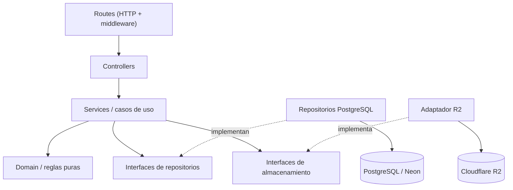

# ADR-006 — Arquitectura modular por capas de Semilla

**Estado:** Aceptada — adopción progresiva.  
**Fecha:** 23 de noviembre de 2026.  
**Ámbito:** Backend Express/TypeScript, frontend React/Vite/TypeScript, integraciones, calidad y evolución.  
**Relación:** complementa ADR-001 (monolito modular), ADR-002 (aislamiento multi-organización), ADR-003 (evidencias y resultados), ADR-004 (migración incremental), ADR-005 (Proyectos) y la decisión específica de Donantes y brigadas. No sustituye los contratos de seguridad vigentes.

## 1. Contexto y problema

Semilla es una aplicación cliente-servidor de gestión comunitaria, con frontend React independiente y **una API Express desplegada como monolito modular**. PostgreSQL/Neon conserva los datos de múltiples organizaciones y Cloudflare R2 aloja evidencias privadas.

La implementación actual usa módulos funcionales, pero la separación por capas es desigual: existen rutas que contienen lógica y consultas SQL, servicios que acceden directamente a PostgreSQL y un cliente HTTP de frontend centralizado en `src/lib/api.ts`. Mover un archivo a `modules/` no equivale a separar sus responsabilidades. Los cambios futuros no deben poner en riesgo los permisos, el aislamiento entre organizaciones, las evidencias, la auditoría ni las funcionalidades ya entregadas.

## 2. Decisión

**Se adopta un monolito modular organizado por funcionalidades con separación explícita de responsabilidades por capas.** Se mantiene una sola API y una sola unidad de despliegue de backend; no se introducen microservicios ni una reescritura completa.

Los nombres de carpetas propuestos son convenciones de destino. Durante la migración se permiten archivos `*.routes.ts`, `*.service.ts` y `*.repository.ts` directamente dentro del módulo, siempre que respeten las mismas responsabilidades. Las estructuras se crean conforme haya código real, sin carpetas vacías.

### 2.1 Backend: responsabilidades y límites

| Capa | Responsabilidad | No debe hacer |
|---|---|---|
| **Routes** | Registrar endpoints, métodos HTTP y middleware de autenticación/autorización; enlazar controladores. | Contener SQL, transacciones o reglas de negocio. |
| **Controllers** | Obtener `req`, contexto autenticado y parámetros; validar formato de entrada; invocar casos de uso; traducir resultados/errores en respuestas HTTP. | Ejecutar consultas SQL, decidir reglas complejas, administrar transacciones o importar repositorios. |
| **Services / casos de uso** | Coordinar reglas de negocio, verificaciones de permisos de dominio, operaciones entre capacidades y dependencias externas por interfaces; definir límites de operaciones. | Conocer `Request`, `Response`, routers o códigos HTTP; emitir SQL. |
| **Domain / validators** | Tipos, invariantes, transiciones de estado y validaciones puras de negocio; validación de esquemas de entrada reutilizable. | Acceder a HTTP, PostgreSQL, almacenamiento o variables de entorno. |
| **Repositories** | Encapsular consultas parametrizadas, mapeo entre filas y entidades, persistencia y operaciones transaccionales. Deben aplicar restricciones de organización en SQL. | Interpretar `req`/`res`, tomar decisiones HTTP, enviar respuestas al usuario. |
| **Shared / infrastructure** | Proveer conexiones, transacciones, autenticación, servicios R2, registro de errores, observabilidad y utilidades verdaderamente compartidas. | Convertirse en un repositorio genérico de reglas específicas de módulos. |

Para operaciones compuestas, el **servicio define el caso de uso y sus reglas**, y una unidad de trabajo / repositorio transaccional garantiza atomicidad. Una consulta de verificación aislada no reemplaza la validación dentro de la misma transacción cuando existe riesgo de concurrencia.

### 2.2 Dependencias admitidas



- Dependencias dentro de un módulo: `routes → controllers → services → contratos de repositorios`; los repositorios concretos se inyectan o se componen en el punto de ensamblaje. La capa de dominio no depende de capas externas.
- El wiring o composición de dependencias podrá residir en `module.ts`, `container.ts` o fábrica equivalente, sin imponer un contenedor de inyección de dependencias.
- Middleware transversal puede actuar antes de los controladores; los servicios aplican además reglas de autorización vinculadas a datos/propiedad.
- Comunicación entre módulos: mediante **interfaces públicas de servicios / casos de uso**, eventos internos o contratos explícitos; evitar importaciones de repositorios o tablas internas de otro módulo.
- Excepciones de transición documentadas y con vencimiento: adaptadores `export *` y consumidores históricos mientras migran. No se introducirán dependencias circulares nuevas.

**Prohibido para código nuevo:** `*.routes.ts` o `*.controller.ts` con `.query(`, SQL embebido o llamadas directas a `databasePool`; servicios importando tipos de Express; acceso desde frontend a Neon, R2 privado o secretos de backend; importaciones entre módulos de archivos internos de persistencia.

## 3. Multi-organización, autorización, auditoría y datos

1. `organizacionId` se deriva de la sesión validada en middleware, se propaga como dato explícito a servicios y repositorios y **nunca se confía al cuerpo de la petición como autorización**.
2. Las consultas SQL de datos institucionales aplican el filtro por organización y, cuando corresponde, por proyecto, brigada, relación de donación y titularidad. Un UUID válido no concede acceso.
3. El acceso a datos del portal DONANTE se limita por asignaciones vigentes; ni `ADMINISTRADOR` institucional ni `SUPERADMINISTRADOR` anulan implícitamente las restricciones de otro tenant.
4. Los permisos de endpoint y los controles de transición de estado se verifican en backend, nunca solo ocultando botones de React.
5. Cierres, reaperturas, validaciones, correcciones y movimientos sensibles deben tener auditoría con actor, fecha, estado previo, estado nuevo y motivo cuando aplique.
6. Las operaciones que requieren consistencia usan transacciones; las comprobaciones críticas se revalidan bajo bloqueos o sentencias atómicas. No hacer llamadas externas R2 dentro de transacciones largas de PostgreSQL.
7. Usar SQL parametrizado, migraciones versionadas y restricciones de base de datos como defensa adicional. Jamás cambiar producción automáticamente por una refactorización.
8. Las fotografías/evidencias privadas se obtienen mediante autorización en backend y URLs firmadas de corta duración o proxy controlado, sin exponer secretos.

## 4. Frontend: estructura basada en funcionalidades

El frontend permanece en React + Vite + TypeScript. El nombre actual `modulos/` puede mantenerse durante la transición; `features/` es un nombre objetivo opcional, **no un cambio funcional obligatorio**.

```text
frontend/src/
├── app/
│   ├── App.tsx                  # ensamblaje y navegación
│   ├── providers/              # sesión y contexto transversal
│   └── navigation/
├── features/                   # o modulos/ durante la transición
│   ├── proyectos/
│   │   ├── pages/
│   │   ├── components/
│   │   ├── hooks/
│   │   ├── api/                # clientes y tipos del módulo
│   │   ├── domain/             # modelos y validaciones de UI
│   │   └── styles/
│   ├── donantes/
│   ├── comunidades/
│   └── ...
├── shared/
│   ├── components/             # controles sin dependencia del dominio
│   ├── hooks/
│   ├── api/httpClient.ts       # fetch, headers, errores, sesión
│   ├── types/
│   └── utils/
└── main.tsx
```

**Reglas de dependencia del frontend:**

- `app` compone módulos; una funcionalidad depende de `shared` y de sus propios archivos.
- Módulos distintos se integran mediante API pública tipada, hooks públicos o estado de aplicación, no mediante importaciones arbitrarias de componentes internos.
- `shared/components` no importa funciones del negocio de Proyectos, Donantes, etc.
- `shared/api/httpClient.ts` centraliza URL base, serialización, autenticación/renovación de sesión, errores HTTP y política de reintentos segura. Cada feature conserva endpoints, tipos y adaptadores propios.
- Los componentes de pantalla coordinan presentación; la carga/actualización de datos y lógica reutilizable se extraen a hooks; los formularios mantienen el estado local mientras tenga alcance local.
- El estado de sesión y organización activa es transversal; para datos remotos compartidos se evalúa una solución de caché/consultas cuando aporte valor. **Zustand, Redux o una biblioteca nueva no son requisitos obligatorios**.
- No duplicar permisos como fuente de verdad: React puede ocultar controles por experiencia de usuario, pero el backend autoriza cada operación.

## 5. Estructura objetivo del backend

```text
backend/src/
├── server.ts
├── modules/
│   ├── proyectos/
│   │   ├── routes/
│   │   ├── controllers/
│   │   ├── services/
│   │   ├── repositories/
│   │   ├── domain/
│   │   ├── validators/
│   │   └── index.ts            # interfaz pública del módulo
│   ├── donantes/
│   ├── comunidades/
│   ├── familias/
│   ├── usuarios/
│   └── pagos/
└── shared/
    ├── database/
    ├── middleware/
    ├── security/
    ├── errors/
    └── storage/
```

Las capacidades transversales existentes en `config/`, `middleware/`, `security/` y `services/` se migran gradualmente solo cuando haya beneficios comprobables. Los archivos internos de un módulo no son APIs públicas.

## 6. Estrategia de implementación sin reescritura

1. **Línea base**: documentar endpoints, roles, contratos JSON, pruebas y dependencias actuales. La implementación vigente sigue funcionando.
2. **Módulo patrón: Proyectos**: separar controladores de rutas, mover orquestación de cierre/avance a servicios, dejar repositorios exclusivamente para persistencia; validar caso de uso y seguridad. Conservar interfaces y rutas actuales.
3. **Donantes y brigadas**: retirar SQL directo de `donantes.routes.ts`; definir servicios de gestión, portal y asociaciones con contexto multi-tenant explícito. Seguir ADR específico.
4. **Comunidades, Familias, Usuarios y Pagos**: una capacidad a la vez, con pruebas de regresión, sin refactor transversal indiscriminado.
5. **React**: extraer `lib/api.ts` por feature detrás de un `httpClient` común; migrar consumidores sin romper tipos públicos; reducir `App.tsx` y pantallas largas mediante componentes y hooks.
6. **Límites automáticos**: introducir comprobaciones por carpeta que detecten SQL en routes/controllers, importaciones de Express en services/domain, ciclos y dependencias prohibidas entre features, con listas de excepciones temporales verificadas.
7. **Retirada**: eliminar adaptadores antiguos únicamente cuando no tengan consumidores y existan pruebas equivalentes.

Cada migración debe ser **pequeña, reversible y enfocada en una responsabilidad**, en `develop` y PR separado hacia `main` tras validación. Durante un refactor no mezclar cambios de arquitectura con cambios de comportamiento, permisos o esquema de datos, salvo necesidad justificada.

## 7. Criterios de aceptación por módulo

Un módulo se considera **separado por capas** únicamente si:

- Rutas solo registran HTTP/middleware y delegan a controladores.
- Controladores transforman entrada/salida HTTP y no contienen SQL ni decisiones complejas.
- Servicios implementan casos de uso sin importar Express ni ejecutar SQL.
- Repositorios encapsulan toda persistencia, transacciones y filtros de tenant.
- El dominio puede probarse sin Express, Neon ni servicios externos.
- No se introducen ciclos o importaciones entre módulos a implementaciones privadas.
- Existen pruebas de rutas, reglas, persistencia con organización, roles/autorización, errores, auditoría y regresión relevantes.
- Compilan frontend/backend y pasan las verificaciones de CI; las pruebas funcionales críticas se ejecutan en entorno `development` antes del PR a `main`.
- Se actualizan documentación, diagramas y registro de decisiones cuando cambia el contrato arquitectónico.

**No equivale a cumplimiento**: renombrar archivos, mover un router a `modules/`, tener carpetas vacías o pasar solamente `npm run build`.

## 8. Riesgos, consecuencias y decisiones descartadas

**Beneficios esperados:** menor acoplamiento, mantenimiento por capacidad, seguridad comprobable, pruebas aisladas, incorporación ordenada de nuevas funciones y mejor legibilidad.

**Costos/riesgos:** mayor número de archivos, interfaces adicionales y regresiones potenciales al mover lógica. Se mitigan con migración incremental, contratos estables y pruebas.

**Descartadas ahora:** reescritura completa, microservicios, cambio masivo de ORM, renombrado global del frontend o incorporación prematura de Redux/Zustand. Se reevaluarán solo ante una necesidad operativa medible.

## 9. Gobernanza y cumplimiento

- Este ADR es **normativo para código nuevo** desde su aceptación y **objetivo de migración** para código histórico.
- Una excepción requiere explicación en el PR, responsable, alcance y condición para retirarla.
- La revisión de PR debe incluir un apartado «impacto arquitectónico»: dependencia nueva, capas afectadas, seguridad tenant, migración/retrocompatibilidad y evidencia de pruebas.
- Mantener actualizado `docs/arquitectura.md` con los diagramas `actual` y `objetivo`, diferenciados, para no presentar como terminado lo que está en transición.
- El avance del refactor se mide por módulos con capas verificadas, SQL restante fuera de repositorios, excepciones pendientes, ciclos detectados y cobertura de escenarios críticos, **sin usar una nota porcentual arbitraria**.

## 10. Próxima acción

Iniciar una revisión de cumplimiento de **Proyectos** y registrar los incumplimientos en una lista de trabajo pequeña antes de editar código. Posteriormente aplicar el mismo patrón a Donantes, manteniendo el estado actual de producción y los contratos públicos.
