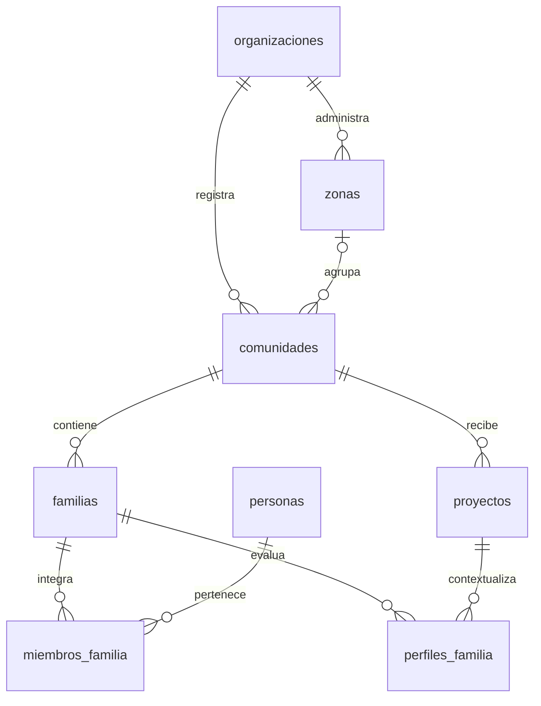
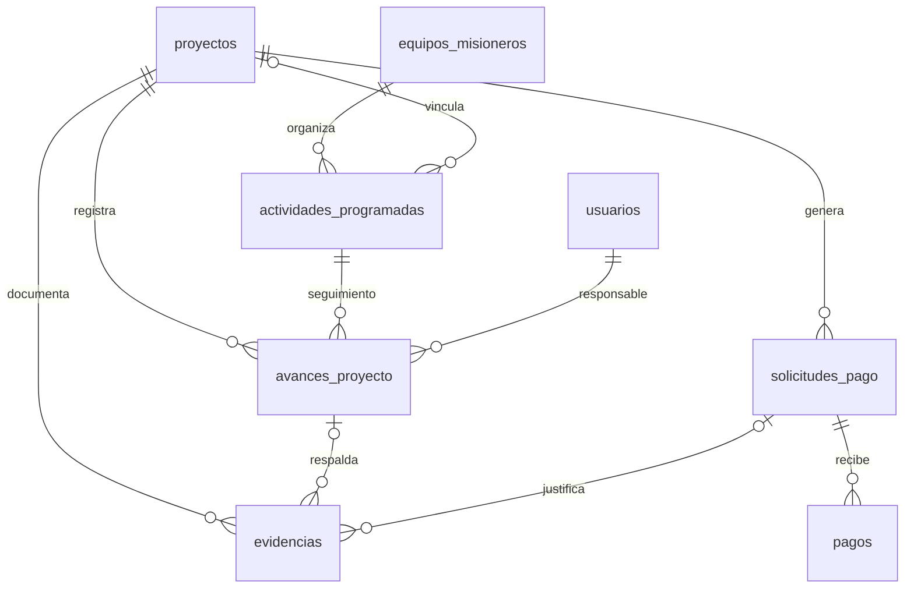
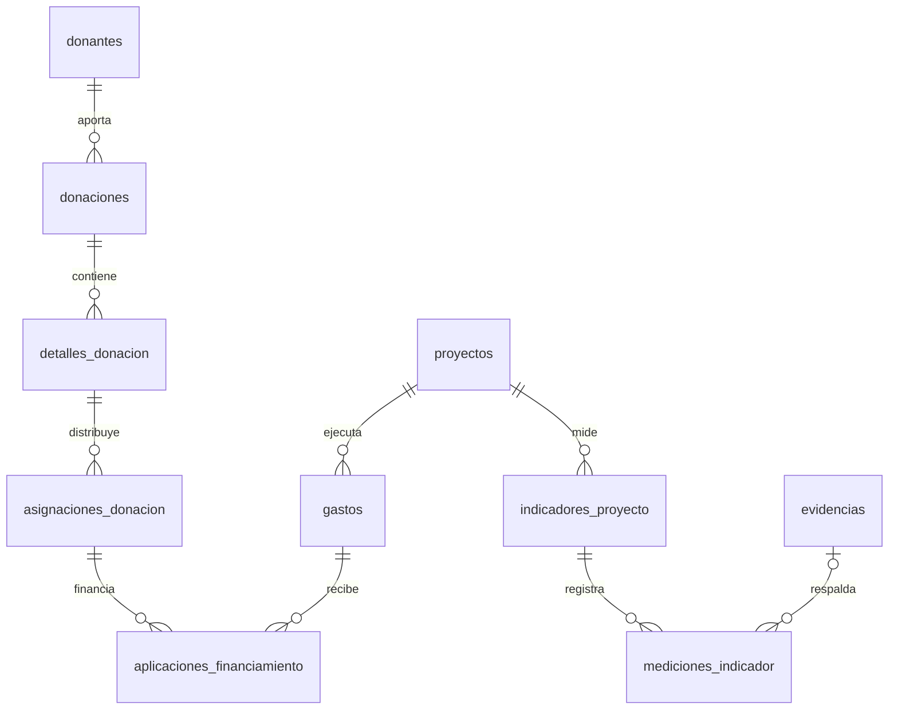

# Modelo de datos del producto completo — Semilla

**Recursos que generan desarrollo.** Corte documental: 7 de noviembre de 2026.

## 1. Alcance y fuentes de verdad

Semilla relaciona territorio, familias, proyectos y recursos para Ministerio Sal y Luz, con evolución hacia varias organizaciones. Este documento reúne el esquema existente y el diseño objetivo del producto completo. **Una tabla definida no significa que su módulo tenga interfaz, API o pruebas completas.**

- Esquema existente: [SQL inicial](../database/sql/001_esquema_inicial.sql), [roles y permisos](../database/sql/002_configurar_roles_permisos.sql), [organizaciones](../database/sql/003_multi_organizacion_base.sql) y [aislamiento territorial](../database/sql/004_aislamiento_territorial.sql).
- Representación ORM: [schema.prisma](../backend/prisma/schema.prisma), con 29 modelos: 28 iniciales y `organizaciones`.
- Alcance funcional: [visión](vision.md), [historias](mapa-historias.md) y [arquitectura multi-organización](arquitectura/multi-organizacion.md).
- El [modelo relacional inicial](../database/modelo-relacional.md) es un antecedente conceptual en inglés; los nombres vigentes se documentan aquí en español.

El stack del repositorio es React + TypeScript, Node.js + Express y PostgreSQL/Neon. Prisma describe el esquema; los servicios territoriales actuales ejecutan consultas parametrizadas con `pg`.

## 2. Convenciones

Tablas y campos en español, plural y `snake_case`, sin tildes. PK UUID; las tablas puente de seguridad tienen PK compuesta. FK con sufijo `_id`. Dinero en `numeric(14,2)`, cantidades propuestas en `numeric(14,3)`, porcentajes en `numeric(5,2)`. Instantes en `timestamptz`; fechas de negocio en `date`. `?` en Prisma indica nulabilidad, no ausencia de validación.

Los nombres de las entidades no son identificadores: se relacionan por UUID. Contraseñas y tokens se almacenan como hash. Fotografías y comprobantes se guardan fuera de PostgreSQL; la base conserva referencias y metadatos. Las URL privadas deben resolverse mediante autorización, no hacerse públicas por defecto.

## 3. Relaciones del núcleo existente

Una comunidad puede existir sin zona en el esquema; la API de registro exige una zona activa de la misma organización. Actualmente cada proyecto pertenece a una comunidad. La ampliación a varias comunidades se propone más adelante.

## 4. Diccionario del esquema existente

Los campos, tipos y relaciones siguientes se extrajeron del `schema.prisma` versionado. Los `CHECK`, índices por expresión y acciones referenciales deben contrastarse con los scripts SQL, que conservan reglas que no se representan completamente en Prisma. No se afirma haber inspeccionado la base remota en esta entrega.

### 4.1. `organizaciones`

| Campo | Tipo Prisma / PostgreSQL | Nulo | Restricciones y valores por defecto |
|---|---|---|---|
| `id` | `String` / `Uuid` | No | `@id @default(dbgenerated("gen_random_uuid()"))` |
| `nombre` | `String` / `VarChar(180)` | No | — |
| `slug` | `String` / `VarChar(120)` | No | `@unique` |
| `nombre_legal` | `String` / `VarChar(220)` | Sí | — |
| `email_contacto` | `String` / `VarChar(150)` | Sí | — |
| `telefono_contacto` | `String` / `VarChar(40)` | Sí | — |
| `pais` | `String` / `VarChar(100)` | No | `@default("Honduras")` |
| `moneda` | `String` / `VarChar(10)` | No | `@default("HNL")` |
| `activo` | `Boolean` / `boolean` | No | `@default(true)` |
| `creado_en` | `DateTime` / `Timestamptz(6)` | No | `@default(now())` |
| `actualizado_en` | `DateTime` / `Timestamptz(6)` | No | `@default(now())` |

### 4.2. `roles`

| Campo | Tipo Prisma / PostgreSQL | Nulo | Restricciones y valores por defecto |
|---|---|---|---|
| `id` | `String` / `Uuid` | No | `@id @default(dbgenerated("gen_random_uuid()"))` |
| `nombre` | `String` / `VarChar(60)` | No | `@unique` |
| `descripcion` | `String` / `text` | Sí | — |
| `activo` | `Boolean` / `boolean` | No | `@default(true)` |
| `creado_en` | `DateTime` / `Timestamptz(6)` | No | `@default(now())` |
| `actualizado_en` | `DateTime` / `Timestamptz(6)` | No | `@default(now())` |

### 4.3. `actividades_programadas`

| Campo | Tipo Prisma / PostgreSQL | Nulo | Restricciones y valores por defecto |
|---|---|---|---|
| `id` | `String` / `Uuid` | No | `@id @default(dbgenerated("gen_random_uuid()"))` |
| `equipo_misionero_id` | `String` / `Uuid` | Sí | — |
| `proyecto_id` | `String` / `Uuid` | Sí | — |
| `nombre` | `String` / `VarChar(180)` | No | — |
| `descripcion` | `String` / `text` | Sí | — |
| `fecha_inicio` | `DateTime` / `Date` | Sí | — |
| `fecha_fin` | `DateTime` / `Date` | Sí | — |
| `estado` | `String` / `VarChar(20)` | No | `@default("PLANIFICADA")` |
| `responsable_asignado_usuario_id` | `String` / `Uuid` | Sí | Responsable operativo; usuario activo de la organización del proyecto |
| `meta_cantidad` | `Decimal` / `Decimal(14, 3)` | Sí | Si está definida, requiere unidad no vacía y valor mayor que cero |
| `unidad_medida` | `String` / `VarChar(80)` | Sí | Se define junto con `meta_cantidad` |
| `presupuesto_estimado` | `Decimal` / `Decimal(14, 2)` | Sí | No negativo; suma de asignaciones no supera el presupuesto del proyecto |
| `peso_resultado` | `Decimal` / `Decimal(5, 2)` | Sí | Peso explícito entre 0 y 100, independiente del presupuesto |
| `creado_en` | `DateTime` / `Timestamptz(6)` | No | `@default(now())` |
| `actualizado_en` | `DateTime` / `Timestamptz(6)` | No | `@default(now())` |

Relaciones salientes:

- `equipos_misioneros` → `equipos_misioneros`: `@relation(fields: [equipo_misionero_id], references: [id], onDelete: Cascade)`.
- `proyectos` → `proyectos`: `@relation(fields: [proyecto_id], references: [id])`.
- `avances_proyecto` → `avances_proyecto`: historial de ejecución de la actividad.

Claves e índices declarados:

- `@@unique([id, proyecto_id], map: "uq_actividades_id_proyecto")`
- `@@index([equipo_misionero_id], map: "idx_actividades_equipo_id")`
- `@@index([proyecto_id], map: "idx_actividades_proyecto_id")`

### 4.4. `avances_proyecto`

| Campo | Tipo Prisma / PostgreSQL | Nulo | Restricciones y valores por defecto |
|---|---|---|---|
| `id` | `String` / `Uuid` | No | `@id @default(dbgenerated("gen_random_uuid()"))` |
| `proyecto_id` | `String` / `Uuid` | No | — |
| `actividad_id` | `String` / `Uuid` | Sí | —; avances nuevos se asocian a una actividad del mismo proyecto |
| `responsable_usuario_id` | `String` / `Uuid` | Sí | —; obligatorio cuando `actividad_id` no es nulo |
| `personal_contratado_id` | `String` / `Uuid` | Sí | — |
| `porcentaje_avance` | `Decimal` / `Decimal(5, 2)` | Sí | Estimación acumulada entre 0 y 100, exclusiva de actividades no cuantificables |
| `clave_idempotencia` | `String` / `Uuid` | Sí | Clave única para reintentos de registro |
| `cantidad_reportada` | `Decimal` / `Decimal(14, 3)` | Sí | Cantidad incremental positiva; exclusiva de avances porcentuales |
| `observaciones` | `String` / `text` | Sí | Obligatoria para justificar estimaciones porcentuales |
| `estado_revision` | `String` / `VarChar(20)` | No | `BORRADOR`, `ENVIADO`, `VALIDADO` o `DEVUELTO`; nuevos avances inician como borrador |
| `revisor_usuario_id` | `String` / `Uuid` | Sí | Responsable de validar o devolver; distinto del autor |
| `revisado_en` | `DateTime` / `Timestamptz(6)` | Sí | Fecha de revisión |
| `motivo_devolucion` | `String` / `text` | Sí | Obligatorio para avances devueltos |
| `fecha_avance` | `DateTime` / `Date` | No | `@default(dbgenerated("CURRENT_DATE"))` |
| `comentarios` | `String` / `text` | Sí | — |
| `creado_en` | `DateTime` / `Timestamptz(6)` | No | `@default(now())` |
| `actualizado_en` | `DateTime` / `Timestamptz(6)` | No | `@default(now())` |

Relaciones salientes:

- `personal_contratado` → `personal_contratado`: `@relation(fields: [personal_contratado_id], references: [id])`.
- `proyectos` → `proyectos`: `@relation(fields: [proyecto_id], references: [id], onDelete: Cascade)`.
- `actividades_programadas` → `actividades_programadas`: `@relation(fields: [actividad_id], references: [id], onDelete: Restrict)`. La migración 019 agrega además la FK compuesta `(actividad_id, proyecto_id)` para impedir asociar un avance a una actividad de otro proyecto.
- `responsable` → `usuarios`: `@relation(fields: [responsable_usuario_id], references: [id], onDelete: Restrict)`.
- `revisor_usuario_id` → `usuarios`: relación opcional del revisor.

Para avances asociados a actividad, `comentarios` contiene la descripción de lo ejecutado y no puede quedar vacía. Cada avance reporta exactamente una cantidad o una estimación porcentual. Los avances legados de la HU-12 original se conservan como `ENVIADO` por la migración 020 y no afectan los resultados hasta ser validados.

Los resultados físicos se calculan solo con avances `VALIDADO`: las cantidades incrementales se suman y se limitan a la meta; para actividades no cuantificables se usa la última estimación validada, sin sumar porcentajes. El resultado global pondera las actividades con `peso_resultado` y permanece pendiente si falta asignar peso a alguna actividad. Una actividad cancelada conserva su peso con resultado cero. Editar un resultado validado requiere corrección explícita, motivo y nueva revisión; la bitácora conserva valores anteriores y nuevos.

Claves e índices declarados:

- `@@index([actividad_id, proyecto_id, fecha_avance(sort: Desc), creado_en(sort: Desc)], map: "idx_avances_actividad_fecha")`
- `@@index([personal_contratado_id], map: "idx_avances_personal_id")`
- `@@index([proyecto_id], map: "idx_avances_proyecto_id")`
- `@@index([responsable_usuario_id], map: "idx_avances_responsable_usuario_id")`

### 4.5. `bitacora_auditoria`

| Campo | Tipo Prisma / PostgreSQL | Nulo | Restricciones y valores por defecto |
|---|---|---|---|
| `id` | `String` / `Uuid` | No | `@id @default(dbgenerated("gen_random_uuid()"))` |
| `usuario_id` | `String` / `Uuid` | Sí | — |
| `accion` | `String` / `VarChar(80)` | No | — |
| `nombre_entidad` | `String` / `VarChar(100)` | No | — |
| `entidad_id` | `String` / `Uuid` | Sí | — |
| `valores_anteriores` | `Json` / `jsonb` | Sí | — |
| `valores_nuevos` | `Json` / `jsonb` | Sí | — |
| `direccion_ip` | `String` / `Inet` | Sí | — |
| `agente_usuario` | `String` / `text` | Sí | — |
| `creado_en` | `DateTime` / `Timestamptz(6)` | No | `@default(now())` |

Relaciones salientes:

- `usuarios` → `usuarios`: `@relation(fields: [usuario_id], references: [id])`.

Claves e índices declarados:

- `@@index([nombre_entidad, entidad_id], map: "idx_bitacora_entidad")`
- `@@index([usuario_id], map: "idx_bitacora_usuario_id")`

### 4.6. `claves_idempotencia`

| Campo | Tipo Prisma / PostgreSQL | Nulo | Restricciones y valores por defecto |
|---|---|---|---|
| `id` | `String` / `Uuid` | No | `@id @default(dbgenerated("gen_random_uuid()"))` |
| `usuario_id` | `String` / `Uuid` | Sí | — |
| `dispositivo_id` | `String` / `Uuid` | Sí | — |
| `clave_idempotencia` | `String` / `VarChar(150)` | No | `@unique` |
| `metodo_solicitud` | `String` / `VarChar(10)` | No | — |
| `ruta_solicitud` | `String` / `VarChar(250)` | No | — |
| `hash_solicitud` | `String` / `VarChar(128)` | Sí | — |
| `estado_respuesta` | `Int` / `integer` | Sí | — |
| `cuerpo_respuesta` | `Json` / `jsonb` | Sí | — |
| `expira_en` | `DateTime` / `Timestamptz(6)` | Sí | — |
| `creado_en` | `DateTime` / `Timestamptz(6)` | No | `@default(now())` |

Relaciones salientes:

- `dispositivos_sincronizacion` → `dispositivos_sincronizacion`: `@relation(fields: [dispositivo_id], references: [id])`.
- `usuarios` → `usuarios`: `@relation(fields: [usuario_id], references: [id])`.

Claves e índices declarados:

- `@@index([dispositivo_id], map: "idx_idempotencia_dispositivo_id")`
- `@@index([usuario_id], map: "idx_idempotencia_usuario_id")`

### 4.7. `comunidades`

| Campo | Tipo Prisma / PostgreSQL | Nulo | Restricciones y valores por defecto |
|---|---|---|---|
| `id` | `String` / `Uuid` | No | `@id @default(dbgenerated("gen_random_uuid()"))` |
| `organizacion_id` | `String` / `Uuid` | No | — |
| `zona_id` | `String` / `Uuid` | Sí | — |
| `nombre` | `String` / `VarChar(150)` | No | — |
| `barrio_colonia` | `String` / `VarChar(150)` | Sí | — |
| `localidad` | `String` / `VarChar(150)` | Sí | — |
| `municipio` | `String` / `VarChar(120)` | No | — |
| `departamento` | `String` / `VarChar(120)` | No | — |
| `activo` | `Boolean` / `boolean` | No | `@default(true)` |
| `creado_en` | `DateTime` / `Timestamptz(6)` | No | `@default(now())` |
| `actualizado_en` | `DateTime` / `Timestamptz(6)` | No | `@default(now())` |

Relaciones salientes:

- `organizaciones` → `organizaciones`: `@relation(fields: [organizacion_id], references: [id], onDelete: Restrict)`.
- `zonas` → `zonas`: `@relation(fields: [zona_id, organizacion_id], references: [id, organizacion_id], onDelete: Restrict)`.

Claves e índices declarados:

- `@@index([organizacion_id], map: "idx_comunidades_organizacion_id")`
- `@@index([zona_id], map: "idx_comunidades_zona_id")`

### 4.8. `contactos`

| Campo | Tipo Prisma / PostgreSQL | Nulo | Restricciones y valores por defecto |
|---|---|---|---|
| `id` | `String` / `Uuid` | No | `@id @default(dbgenerated("gen_random_uuid()"))` |
| `familia_id` | `String` / `Uuid` | No | — |
| `persona_id` | `String` / `Uuid` | Sí | — |
| `nombre_contacto` | `String` / `VarChar(150)` | No | — |
| `telefono` | `String` / `VarChar(30)` | Sí | — |
| `email` | `String` / `VarChar(150)` | Sí | — |
| `es_principal` | `Boolean` / `boolean` | No | `@default(false)` |
| `observaciones` | `String` / `text` | Sí | — |
| `creado_en` | `DateTime` / `Timestamptz(6)` | No | `@default(now())` |
| `actualizado_en` | `DateTime` / `Timestamptz(6)` | No | `@default(now())` |

Relaciones salientes:

- `familias` → `familias`: `@relation(fields: [familia_id], references: [id], onDelete: Cascade)`.
- `personas` → `personas`: `@relation(fields: [persona_id], references: [id])`.

Claves e índices declarados:

- `@@index([familia_id], map: "idx_contactos_familia_id")`
- `@@index([persona_id], map: "idx_contactos_persona_id")`

### 4.9. `dispositivos_sincronizacion`

| Campo | Tipo Prisma / PostgreSQL | Nulo | Restricciones y valores por defecto |
|---|---|---|---|
| `id` | `String` / `Uuid` | No | `@id @default(dbgenerated("gen_random_uuid()"))` |
| `usuario_id` | `String` / `Uuid` | No | — |
| `uuid_dispositivo` | `String` / `Uuid` | No | `@unique` |
| `nombre_dispositivo` | `String` / `VarChar(150)` | Sí | — |
| `plataforma` | `String` / `VarChar(50)` | Sí | — |
| `ultima_sincronizacion_en` | `DateTime` / `Timestamptz(6)` | Sí | — |
| `activo` | `Boolean` / `boolean` | No | `@default(true)` |
| `creado_en` | `DateTime` / `Timestamptz(6)` | No | `@default(now())` |
| `actualizado_en` | `DateTime` / `Timestamptz(6)` | No | `@default(now())` |

Relaciones salientes:

- `usuarios` → `usuarios`: `@relation(fields: [usuario_id], references: [id], onDelete: Cascade)`.

Claves e índices declarados:

- `@@index([usuario_id], map: "idx_dispositivos_usuario_id")`

### 4.10. `empleados`

| Campo | Tipo Prisma / PostgreSQL | Nulo | Restricciones y valores por defecto |
|---|---|---|---|
| `id` | `String` / `Uuid` | No | `@id @default(dbgenerated("gen_random_uuid()"))` |
| `persona_id` | `String` / `Uuid` | No | `@unique` |
| `cargo` | `String` / `VarChar(100)` | No | — |
| `fecha_ingreso` | `DateTime` / `Date` | No | — |
| `estado` | `String` / `VarChar(20)` | No | `@default("ACTIVO")` |
| `observaciones` | `String` / `text` | Sí | — |
| `creado_en` | `DateTime` / `Timestamptz(6)` | No | `@default(now())` |
| `actualizado_en` | `DateTime` / `Timestamptz(6)` | No | `@default(now())` |

Relaciones salientes:

- `personas` → `personas`: `@relation(fields: [persona_id], references: [id])`.

### 4.11. `equipos_misioneros`

| Campo | Tipo Prisma / PostgreSQL | Nulo | Restricciones y valores por defecto |
|---|---|---|---|
| `id` | `String` / `Uuid` | No | `@id @default(dbgenerated("gen_random_uuid()"))` |
| `zona_id` | `String` / `Uuid` | Sí | — |
| `nombre` | `String` / `VarChar(150)` | No | — |
| `estado` | `String` / `VarChar(20)` | No | `@default("PLANIFICADO")` |
| `presupuesto_total` | `Decimal` / `Decimal(14, 2)` | No | `@default(0)` |
| `fecha_llegada` | `DateTime` / `Date` | Sí | — |
| `fecha_salida` | `DateTime` / `Date` | Sí | — |
| `observaciones` | `String` / `text` | Sí | — |
| `creado_en` | `DateTime` / `Timestamptz(6)` | No | `@default(now())` |
| `actualizado_en` | `DateTime` / `Timestamptz(6)` | No | `@default(now())` |

Relaciones salientes:

- `zonas` → `zonas`: `@relation(fields: [zona_id], references: [id])`.

Claves e índices declarados:

- `@@index([zona_id], map: "idx_equipos_misioneros_zona_id")`

### 4.12. `evidencias`

| Campo | Tipo Prisma / PostgreSQL | Nulo | Restricciones y valores por defecto |
|---|---|---|---|
| `id` | `String` / `Uuid` | No | `@id @default(dbgenerated("gen_random_uuid()"))` |
| `proyecto_id` | `String` / `Uuid` | No | — |
| `avance_proyecto_id` | `String` / `Uuid` | Sí | — |
| `solicitud_pago_id` | `String` / `Uuid` | Sí | — |
| `tipo_evidencia` | `String` / `VarChar(40)` | No | — |
| `titulo` | `String` / `VarChar(180)` | Sí | — |
| `descripcion` | `String` / `text` | Sí | — |
| `archivo_url` | `String` / `text` | No | — |
| `tipo_mime` | `String` / `VarChar(120)` | Sí | — |
| `capturado_en` | `DateTime` / `Timestamptz(6)` | Sí | — |
| `subido_por_usuario_id` | `String` / `Uuid` | Sí | — |
| `creado_en` | `DateTime` / `Timestamptz(6)` | No | `@default(now())` |
| `actualizado_en` | `DateTime` / `Timestamptz(6)` | No | `@default(now())` |

Relaciones salientes:

- `avances_proyecto` → `avances_proyecto`: `@relation(fields: [avance_proyecto_id], references: [id])`.
- `proyectos` → `proyectos`: `@relation(fields: [proyecto_id], references: [id], onDelete: Cascade)`.
- `solicitudes_pago` → `solicitudes_pago`: `@relation(fields: [solicitud_pago_id], references: [id])`.
- `usuarios` → `usuarios`: `@relation(fields: [subido_por_usuario_id], references: [id])`.

Claves e índices declarados:

- `@@index([avance_proyecto_id], map: "idx_evidencias_avance_id")`
- `@@index([proyecto_id], map: "idx_evidencias_proyecto_id")`
- `@@index([solicitud_pago_id], map: "idx_evidencias_solicitud_id")`

### 4.13. `familias`

| Campo | Tipo Prisma / PostgreSQL | Nulo | Restricciones y valores por defecto |
|---|---|---|---|
| `id` | `String` / `Uuid` | No | `@id @default(dbgenerated("gen_random_uuid()"))` |
| `comunidad_id` | `String` / `Uuid` | No | — |
| `numero_casa` | `String` / `VarChar(30)` | Sí | — |
| `nombre_referencia` | `String` / `VarChar(180)` | Sí | — |
| `direccion_referencia` | `String` / `text` | Sí | — |
| `activo` | `Boolean` / `boolean` | No | `@default(true)` |
| `creado_en` | `DateTime` / `Timestamptz(6)` | No | `@default(now())` |
| `actualizado_en` | `DateTime` / `Timestamptz(6)` | No | `@default(now())` |

Relaciones salientes:

- `comunidades` → `comunidades`: `@relation(fields: [comunidad_id], references: [id])`.

Claves e índices declarados:

- `@@index([comunidad_id], map: "idx_familias_comunidad_id")`

### 4.14. `miembros_familia`

| Campo | Tipo Prisma / PostgreSQL | Nulo | Restricciones y valores por defecto |
|---|---|---|---|
| `id` | `String` / `Uuid` | No | `@id @default(dbgenerated("gen_random_uuid()"))` |
| `familia_id` | `String` / `Uuid` | No | — |
| `persona_id` | `String` / `Uuid` | No | — |
| `parentesco_id` | `String` / `Uuid` | Sí | — |
| `es_jefe_hogar` | `Boolean` / `boolean` | No | `@default(false)` |
| `fecha_ingreso` | `DateTime` / `Date` | No | `@default(dbgenerated("CURRENT_DATE"))` |
| `fecha_salida` | `DateTime` / `Date` | Sí | — |
| `creado_en` | `DateTime` / `Timestamptz(6)` | No | `@default(now())` |
| `actualizado_en` | `DateTime` / `Timestamptz(6)` | No | `@default(now())` |

Relaciones salientes:

- `familias` → `familias`: `@relation(fields: [familia_id], references: [id], onDelete: Cascade)`.
- `parentescos` → `parentescos`: `@relation(fields: [parentesco_id], references: [id])`.
- `personas` → `personas`: `@relation(fields: [persona_id], references: [id])`.

Claves e índices declarados:

- `@@unique([familia_id, persona_id])`
- `@@index([familia_id], map: "idx_miembros_familia_familia_id")`
- `@@index([parentesco_id], map: "idx_miembros_familia_parentesco_id")`
- `@@index([persona_id], map: "idx_miembros_familia_persona_id")`

### 4.15. `pagos`

| Campo | Tipo Prisma / PostgreSQL | Nulo | Restricciones y valores por defecto |
|---|---|---|---|
| `id` | `String` / `Uuid` | No | `@id @default(dbgenerated("gen_random_uuid()"))` |
| `solicitud_pago_id` | `String` / `Uuid` | No | — |
| `tipo_pago` | `String` / `VarChar(30)` | No | — |
| `monto` | `Decimal` / `Decimal(14, 2)` | No | — |
| `fecha_pago` | `DateTime` / `Date` | No | `@default(dbgenerated("CURRENT_DATE"))` |
| `estado_pago` | `String` / `VarChar(20)` | No | `@default("REGISTRADO")` |
| `metodo_pago` | `String` / `VarChar(30)` | Sí | — |
| `referencia` | `String` / `VarChar(100)` | Sí | — |
| `foto_comprobante_url` | `String` / `text` | Sí | — |
| `observaciones` | `String` / `text` | Sí | — |
| `creado_en` | `DateTime` / `Timestamptz(6)` | No | `@default(now())` |
| `actualizado_en` | `DateTime` / `Timestamptz(6)` | No | `@default(now())` |

Relaciones salientes:

- `solicitudes_pago` → `solicitudes_pago`: `@relation(fields: [solicitud_pago_id], references: [id])`.

Claves e índices declarados:

- `@@index([solicitud_pago_id], map: "idx_pagos_solicitud_id")`

### 4.16. `parentescos`

| Campo | Tipo Prisma / PostgreSQL | Nulo | Restricciones y valores por defecto |
|---|---|---|---|
| `id` | `String` / `Uuid` | No | `@id @default(dbgenerated("gen_random_uuid()"))` |
| `nombre` | `String` / `VarChar(50)` | No | `@unique` |
| `observaciones` | `String` / `text` | Sí | — |
| `activo` | `Boolean` / `boolean` | No | `@default(true)` |
| `creado_en` | `DateTime` / `Timestamptz(6)` | No | `@default(now())` |

### 4.17. `perfiles_familia`

| Campo | Tipo Prisma / PostgreSQL | Nulo | Restricciones y valores por defecto |
|---|---|---|---|
| `id` | `String` / `Uuid` | No | `@id @default(dbgenerated("gen_random_uuid()"))` |
| `familia_id` | `String` / `Uuid` | No | — |
| `proyecto_id` | `String` / `Uuid` | No | — |
| `numero_integrantes` | `Int` / `integer` | No | — |
| `nivel_riesgo` | `String` / `VarChar(20)` | No | — |
| `numero_habitaciones` | `Int` / `integer` | No | `@default(0)` |
| `area_util_construccion` | `Decimal` / `Decimal(10, 2)` | Sí | — |
| `tipo_vivienda` | `String` / `VarChar(60)` | Sí | — |
| `fecha_perfil` | `DateTime` / `Date` | No | `@default(dbgenerated("CURRENT_DATE"))` |
| `foto_familia_url` | `String` / `text` | Sí | — |
| `ingreso_mensual` | `Decimal` / `Decimal(14, 2)` | Sí | — |
| `observaciones` | `String` / `text` | Sí | — |
| `estado` | `String` / `VarChar(20)` | No | `@default("PENDIENTE")` |
| `creado_en` | `DateTime` / `Timestamptz(6)` | No | `@default(now())` |
| `actualizado_en` | `DateTime` / `Timestamptz(6)` | No | `@default(now())` |

Relaciones salientes:

- `familias` → `familias`: `@relation(fields: [familia_id], references: [id], onDelete: Cascade)`.
- `proyectos` → `proyectos`: `@relation(fields: [proyecto_id], references: [id])`.

Claves e índices declarados:

- `@@unique([familia_id, proyecto_id])`
- `@@index([familia_id], map: "idx_perfiles_familia_familia_id")`
- `@@index([proyecto_id], map: "idx_perfiles_familia_proyecto_id")`

### 4.18. `permisos`

| Campo | Tipo Prisma / PostgreSQL | Nulo | Restricciones y valores por defecto |
|---|---|---|---|
| `id` | `String` / `Uuid` | No | `@id @default(dbgenerated("gen_random_uuid()"))` |
| `codigo` | `String` / `VarChar(100)` | No | `@unique` |
| `modulo` | `String` / `VarChar(80)` | No | — |
| `descripcion` | `String` / `text` | Sí | — |
| `creado_en` | `DateTime` / `Timestamptz(6)` | No | `@default(now())` |

### 4.19. `personal_contratado`

| Campo | Tipo Prisma / PostgreSQL | Nulo | Restricciones y valores por defecto |
|---|---|---|---|
| `id` | `String` / `Uuid` | No | `@id @default(dbgenerated("gen_random_uuid()"))` |
| `persona_id` | `String` / `Uuid` | No | — |
| `proyecto_id` | `String` / `Uuid` | No | — |
| `cargo` | `String` / `VarChar(100)` | No | — |
| `valor_contrato` | `Decimal` / `Decimal(14, 2)` | No | — |
| `tipo_contrato` | `String` / `VarChar(40)` | No | — |
| `fecha_inicio` | `DateTime` / `Date` | Sí | — |
| `fecha_fin` | `DateTime` / `Date` | Sí | — |
| `estado` | `String` / `VarChar(20)` | No | `@default("ACTIVO")` |
| `creado_en` | `DateTime` / `Timestamptz(6)` | No | `@default(now())` |
| `actualizado_en` | `DateTime` / `Timestamptz(6)` | No | `@default(now())` |

Relaciones salientes:

- `personas` → `personas`: `@relation(fields: [persona_id], references: [id])`.
- `proyectos` → `proyectos`: `@relation(fields: [proyecto_id], references: [id])`.

Claves e índices declarados:

- `@@unique([persona_id, proyecto_id, cargo])`
- `@@index([persona_id], map: "idx_personal_contratado_persona_id")`
- `@@index([proyecto_id], map: "idx_personal_contratado_proyecto_id")`

### 4.20. `personas`

| Campo | Tipo Prisma / PostgreSQL | Nulo | Restricciones y valores por defecto |
|---|---|---|---|
| `id` | `String` / `Uuid` | No | `@id @default(dbgenerated("gen_random_uuid()"))` |
| `identidad` | `String` / `VarChar(20)` | Sí | `@unique` |
| `primer_nombre` | `String` / `VarChar(100)` | No | — |
| `segundo_nombre` | `String` / `VarChar(100)` | Sí | — |
| `primer_apellido` | `String` / `VarChar(100)` | No | — |
| `segundo_apellido` | `String` / `VarChar(100)` | Sí | — |
| `ocupacion` | `String` / `VarChar(120)` | Sí | — |
| `estado_civil` | `String` / `VarChar(30)` | Sí | — |
| `genero` | `String` / `VarChar(30)` | Sí | — |
| `telefono` | `String` / `VarChar(30)` | Sí | — |
| `email` | `String` / `VarChar(150)` | Sí | — |
| `fecha_nacimiento` | `DateTime` / `Date` | Sí | — |
| `tipo_persona` | `String` / `VarChar(30)` | Sí | — |
| `activo` | `Boolean` / `boolean` | No | `@default(true)` |
| `creado_en` | `DateTime` / `Timestamptz(6)` | No | `@default(now())` |
| `actualizado_en` | `DateTime` / `Timestamptz(6)` | No | `@default(now())` |

### 4.21. `proveedores`

| Campo | Tipo Prisma / PostgreSQL | Nulo | Restricciones y valores por defecto |
|---|---|---|---|
| `id` | `String` / `Uuid` | No | `@id @default(dbgenerated("gen_random_uuid()"))` |
| `nombre_comercial` | `String` / `VarChar(150)` | No | — |
| `rtn` | `String` / `VarChar(20)` | Sí | `@unique` |
| `propietario` | `String` / `VarChar(150)` | Sí | — |
| `direccion` | `String` / `text` | Sí | — |
| `telefono` | `String` / `VarChar(30)` | Sí | — |
| `email` | `String` / `VarChar(150)` | Sí | — |
| `cuenta_bancaria` | `String` / `VarChar(50)` | Sí | — |
| `observaciones` | `String` / `text` | Sí | — |
| `activo` | `Boolean` / `boolean` | No | `@default(true)` |
| `creado_en` | `DateTime` / `Timestamptz(6)` | No | `@default(now())` |
| `actualizado_en` | `DateTime` / `Timestamptz(6)` | No | `@default(now())` |

### 4.22. `proyectos`

| Campo | Tipo Prisma / PostgreSQL | Nulo | Restricciones y valores por defecto |
|---|---|---|---|
| `id` | `String` / `Uuid` | No | `@id @default(dbgenerated("gen_random_uuid()"))` |
| `comunidad_id` | `String` / `Uuid` | No | — |
| `equipo_misionero_id` | `String` / `Uuid` | Sí | — |
| `nombre` | `String` / `VarChar(200)` | No | — |
| `tipo` | `String` / `VarChar(60)` | No | — |
| `estado` | `String` / `VarChar(20)` | No | `@default("PLANIFICADO")` |
| `presupuesto_asignado` | `Decimal` / `Decimal(14, 2)` | No | `@default(0)` |
| `gastos_administrativos` | `Decimal` / `Decimal(14, 2)` | No | `@default(0)` |
| `fecha_inicio` | `DateTime` / `Date` | No | — |
| `fecha_fin` | `DateTime` / `Date` | Sí | — |
| `descripcion` | `String` / `text` | Sí | — |
| `creado_en` | `DateTime` / `Timestamptz(6)` | No | `@default(now())` |
| `actualizado_en` | `DateTime` / `Timestamptz(6)` | No | `@default(now())` |

Relaciones salientes:

- `comunidades` → `comunidades`: `@relation(fields: [comunidad_id], references: [id])`.
- `equipos_misioneros` → `equipos_misioneros`: `@relation(fields: [equipo_misionero_id], references: [id])`.

Claves e índices declarados:

- `@@index([comunidad_id], map: "idx_proyectos_comunidad_id")`
- `@@index([equipo_misionero_id], map: "idx_proyectos_equipo_misionero_id")`

### 4.23. `roles_permisos`

| Campo | Tipo Prisma / PostgreSQL | Nulo | Restricciones y valores por defecto |
|---|---|---|---|
| `rol_id` | `String` / `Uuid` | No | — |
| `permiso_id` | `String` / `Uuid` | No | — |
| `otorgado_en` | `DateTime` / `Timestamptz(6)` | No | `@default(now())` |

Relaciones salientes:

- `permisos` → `permisos`: `@relation(fields: [permiso_id], references: [id], onDelete: Cascade)`.
- `roles` → `roles`: `@relation(fields: [rol_id], references: [id], onDelete: Cascade)`.

Claves e índices declarados:

- `@@id([rol_id, permiso_id])`

### 4.24. `servicios_basicos`

| Campo | Tipo Prisma / PostgreSQL | Nulo | Restricciones y valores por defecto |
|---|---|---|---|
| `id` | `String` / `Uuid` | No | `@id @default(dbgenerated("gen_random_uuid()"))` |
| `proyecto_id` | `String` / `Uuid` | No | `@unique` |
| `descripcion` | `String` / `text` | Sí | — |
| `estado_terreno` | `String` / `VarChar(50)` | Sí | — |
| `tiene_electricidad` | `Boolean` / `boolean` | No | `@default(false)` |
| `tiene_agua` | `Boolean` / `boolean` | No | `@default(false)` |
| `tiene_pila` | `Boolean` / `boolean` | No | `@default(false)` |
| `tiene_fosa` | `Boolean` / `boolean` | No | `@default(false)` |
| `estatus_ambiental` | `Boolean` / `boolean` | No | `@default(false)` |
| `foto_terreno_url` | `String` / `text` | Sí | — |
| `observaciones` | `String` / `text` | Sí | — |
| `creado_en` | `DateTime` / `Timestamptz(6)` | No | `@default(now())` |
| `actualizado_en` | `DateTime` / `Timestamptz(6)` | No | `@default(now())` |

Relaciones salientes:

- `proyectos` → `proyectos`: `@relation(fields: [proyecto_id], references: [id], onDelete: Cascade)`.

### 4.25. `solicitudes_pago`

| Campo | Tipo Prisma / PostgreSQL | Nulo | Restricciones y valores por defecto |
|---|---|---|---|
| `id` | `String` / `Uuid` | No | `@id @default(dbgenerated("gen_random_uuid()"))` |
| `proyecto_id` | `String` / `Uuid` | No | — |
| `avance_proyecto_id` | `String` / `Uuid` | Sí | — |
| `proveedor_id` | `String` / `Uuid` | Sí | — |
| `personal_contratado_id` | `String` / `Uuid` | Sí | — |
| `empleado_id` | `String` / `Uuid` | Sí | — |
| `fecha_solicitud` | `DateTime` / `Date` | No | `@default(dbgenerated("CURRENT_DATE"))` |
| `concepto` | `String` / `VarChar(250)` | No | — |
| `valor_solicitado` | `Decimal` / `Decimal(14, 2)` | No | — |
| `anticipo` | `Decimal` / `Decimal(14, 2)` | No | `@default(0)` |
| `estado` | `String` / `VarChar(20)` | No | `@default("SOLICITADA")` |
| `fecha_confirmacion` | `DateTime` / `Date` | Sí | — |
| `observaciones` | `String` / `text` | Sí | — |
| `creado_en` | `DateTime` / `Timestamptz(6)` | No | `@default(now())` |
| `actualizado_en` | `DateTime` / `Timestamptz(6)` | No | `@default(now())` |

Relaciones salientes:

- `avances_proyecto` → `avances_proyecto`: `@relation(fields: [avance_proyecto_id], references: [id])`.
- `empleados` → `empleados`: `@relation(fields: [empleado_id], references: [id], onDelete: Restrict)`.
- `personal_contratado` → `personal_contratado`: `@relation(fields: [personal_contratado_id], references: [id], onDelete: Restrict)`.
- `proveedores` → `proveedores`: `@relation(fields: [proveedor_id], references: [id], onDelete: Restrict)`.
- `proyectos` → `proyectos`: `@relation(fields: [proyecto_id], references: [id])`.

Claves e índices declarados:

- `@@index([avance_proyecto_id], map: "idx_solicitudes_pago_avance_id")`
- `@@index([empleado_id], map: "idx_solicitudes_pago_empleado_id")`
- `@@index([personal_contratado_id], map: "idx_solicitudes_pago_personal_id")`
- `@@index([proveedor_id], map: "idx_solicitudes_pago_proveedor_id")`
- `@@index([proyecto_id], map: "idx_solicitudes_pago_proyecto_id")`

### 4.26. `tokens_refresco`

| Campo | Tipo Prisma / PostgreSQL | Nulo | Restricciones y valores por defecto |
|---|---|---|---|
| `id` | `String` / `Uuid` | No | `@id @default(dbgenerated("gen_random_uuid()"))` |
| `usuario_id` | `String` / `Uuid` | No | — |
| `hash_token` | `String` / `text` | No | `@unique` |
| `expira_en` | `DateTime` / `Timestamptz(6)` | No | — |
| `revocado_en` | `DateTime` / `Timestamptz(6)` | Sí | — |
| `direccion_ip` | `String` / `Inet` | Sí | — |
| `agente_usuario` | `String` / `text` | Sí | — |
| `creado_en` | `DateTime` / `Timestamptz(6)` | No | `@default(now())` |

Relaciones salientes:

- `usuarios` → `usuarios`: `@relation(fields: [usuario_id], references: [id], onDelete: Cascade)`.

Claves e índices declarados:

- `@@index([usuario_id], map: "idx_tokens_refresco_usuario_id")`

### 4.27. `usuarios`

| Campo | Tipo Prisma / PostgreSQL | Nulo | Restricciones y valores por defecto |
|---|---|---|---|
| `id` | `String` / `Uuid` | No | `@id @default(dbgenerated("gen_random_uuid()"))` |
| `organizacion_id` | `String` / `Uuid` | No | — |
| `empleado_id` | `String` / `Uuid` | Sí | `@unique` |
| `email` | `String` / `VarChar(150)` | No | `@unique` |
| `hash_contrasena` | `String` / `text` | No | — |
| `activo` | `Boolean` / `boolean` | No | `@default(true)` |
| `debe_cambiar_contrasena` | `Boolean` / `boolean` | No | `@default(false)` |
| `ultimo_acceso_en` | `DateTime` / `Timestamptz(6)` | Sí | — |
| `creado_en` | `DateTime` / `Timestamptz(6)` | No | `@default(now())` |
| `actualizado_en` | `DateTime` / `Timestamptz(6)` | No | `@default(now())` |

Relaciones salientes:

- `empleados` → `empleados`: `@relation(fields: [empleado_id], references: [id])`.
- `organizaciones` → `organizaciones`: `@relation(fields: [organizacion_id], references: [id], onDelete: Restrict)`.

Claves e índices declarados:

- `@@index([empleado_id], map: "idx_usuarios_empleado_id")`
- `@@index([organizacion_id], map: "idx_usuarios_organizacion_id")`

### 4.28. `usuarios_roles`

| Campo | Tipo Prisma / PostgreSQL | Nulo | Restricciones y valores por defecto |
|---|---|---|---|
| `usuario_id` | `String` / `Uuid` | No | — |
| `rol_id` | `String` / `Uuid` | No | — |
| `asignado_en` | `DateTime` / `Timestamptz(6)` | No | `@default(now())` |

Relaciones salientes:

- `roles` → `roles`: `@relation(fields: [rol_id], references: [id], onDelete: Cascade)`.
- `usuarios` → `usuarios`: `@relation(fields: [usuario_id], references: [id], onDelete: Cascade)`.

Claves e índices declarados:

- `@@id([usuario_id, rol_id])`

### 4.29. `zonas`

| Campo | Tipo Prisma / PostgreSQL | Nulo | Restricciones y valores por defecto |
|---|---|---|---|
| `id` | `String` / `Uuid` | No | `@id @default(dbgenerated("gen_random_uuid()"))` |
| `organizacion_id` | `String` / `Uuid` | No | — |
| `nombre` | `String` / `VarChar(100)` | No | — |
| `descripcion` | `String` / `text` | Sí | — |
| `activo` | `Boolean` / `boolean` | No | `@default(true)` |
| `creado_en` | `DateTime` / `Timestamptz(6)` | No | `@default(now())` |
| `actualizado_en` | `DateTime` / `Timestamptz(6)` | No | `@default(now())` |

Relaciones salientes:

- `organizaciones` → `organizaciones`: `@relation(fields: [organizacion_id], references: [id], onDelete: Restrict)`.

Claves e índices declarados:

- `@@unique([id, organizacion_id], map: "uq_zonas_id_organizacion")`
- `@@index([organizacion_id], map: "idx_zonas_organizacion_id")`

## 5. Modelo objetivo: ampliaciones del producto completo

**Estado: diseño propuesto, pendiente de migraciones y módulos.** Todas las tablas nuevas de operación incorporarán `id uuid PK`, `organizacion_id uuid NOT NULL FK organizaciones`, `creado_en` y `actualizado_en timestamptz`. Los campos listados son obligatorios salvo `?`. Los catálogos globales actuales se conservan. Para sincronización se añadirán `version integer DEFAULT 1` y `eliminado_en timestamptz?` a las entidades que realmente se editen en campo.

Las FK entre datos organizacionales serán compuestas `(entidad_id, organizacion_id)` y apuntarán a `UNIQUE(id, organizacion_id)` del padre. Se extenderá esta garantía a las tablas existentes antes de habilitar sus módulos para varias ONG. Los importes tendrán moneda explícita; no se sumarán monedas distintas sin conversión registrada.

### 5.1. Territorio, expediente y necesidades

| Tabla propuesta | Campos específicos y relaciones | Regla principal |
|---|---|---|
| `diagnosticos_comunidad` | `comunidad_id uuid FK comunidades`, `fecha date`, `poblacion integer`, `viviendas integer`, `observaciones text?` | Conteos no negativos; historial por fecha, sin sobrescribir diagnósticos anteriores. |
| `areas_desarrollo` | `nombre varchar(100)`, `activo boolean` | Nombre único por organización; educación, evangelismo e infraestructura como datos de catálogo. |
| `visiones_comunidad` | `diagnostico_id uuid FK diagnosticos_comunidad`, `area_id uuid FK areas_desarrollo`, `situacion_actual text`, `prioridad varchar(20)`, `meta text` | Único diagnóstico/área. Prioridad BAJA, MEDIA o ALTA. |
| `organizaciones_comunitarias` | `comunidad_id uuid FK comunidades`, `nombre varchar(180)`, `tipo varchar(80)`, `contacto text?`, `activo boolean` | Organizaciones locales; no son las ONG raíz de la plataforma. |
| `actividades_productivas` | `comunidad_id uuid FK comunidades`, `nombre varchar(150)`, `descripcion text?` | Registros separados para evitar listas en un solo campo. |
| `tipos_necesidad` | `nombre varchar(100)`, `descripcion text?` | Nombre único por organización. |
| `necesidades` | `tipo_necesidad_id uuid FK tipos_necesidad`, `comunidad_id uuid? FK comunidades`, `familia_id uuid? FK familias`, `descripcion text`, `prioridad varchar(20)`, `estado varchar(20)` | Exactamente un contexto: comunidad o familia; estado ABIERTA, EN_ATENCION, RESUELTA o CANCELADA. |

Extender `comunidades` con `latitud numeric(9,6)?` y `longitud numeric(9,6)?`: ambas nulas o ambas presentes; latitud entre -90 y 90 y longitud entre -180 y 180. Los conteos del diagnóstico representan una medición fechada; no sustituyen el conteo de personas registradas.

### 5.2. Planificación, ejecución e impacto

| Tabla propuesta | Campos específicos y relaciones | Regla principal |
|---|---|---|
| `programas` | `nombre varchar(180)`, `descripcion text?`, `activo boolean` | Agrupa proyectos. |
| `planes_operativos` | `programa_id uuid FK programas`, `anio integer`, `estado varchar(20)` | Único programa/año; BORRADOR, APROBADO, CERRADO. |
| `objetivos_estrategicos` | `plan_id uuid FK planes_operativos`, `descripcion text` | Cada objetivo pertenece a un POA. |
| `metas_estrategicas` | `objetivo_id uuid FK objetivos_estrategicos`, `descripcion text`, `unidad varchar(50)`, `valor_meta numeric(14,3)` | Meta no negativa y unidad definida. |
| `proyectos_comunidades` | `proyecto_id uuid FK proyectos`, `comunidad_id uuid FK comunidades` | Único proyecto/comunidad. |
| `proyectos_necesidades` | `proyecto_id uuid FK proyectos`, `necesidad_id uuid FK necesidades` | Único proyecto/necesidad. |
| `beneficiarios_actividad` | `actividad_id uuid FK actividades_programadas`, `familia_id uuid? FK familias`, `persona_id uuid? FK personas`, `fecha date` | Exactamente familia o persona; índices únicos parciales por actividad/beneficiario. |
| `indicadores_proyecto` | `proyecto_id uuid FK proyectos`, `nombre varchar(150)`, `unidad varchar(50)`, `linea_base numeric(14,3)`, `meta numeric(14,3)` | Definir qué se mide, no inferir impacto solo del gasto. |
| `mediciones_indicador` | `indicador_id uuid FK indicadores_proyecto`, `fecha date`, `valor numeric(14,3)`, `evidencia_id uuid? FK evidencias` | Conservar mediciones históricas. |

Agregar a `proyectos` `programa_id`, `meta_estrategica_id`, `codigo` único por organización y `nombre_publico?`. Migrar `comunidad_id` a `proyectos_comunidades` preservando todas las relaciones existentes antes de retirarlo. En `actividades_programadas`, permitir actividades sin equipo misionero y exigir proyecto o equipo, para representar el trabajo ordinario del programa.

### 5.3. Donantes, donaciones, asignaciones y recursos

| Tabla propuesta | Campos específicos y relaciones | Regla principal |
|---|---|---|
| `donantes` | `nombre varchar(180)`, `tipo varchar(20)`, `email varchar(150)?`, `telefono varchar(40)?`, `activo boolean` | PERSONA o INSTITUCION; el donante es distinto de su cuenta de acceso. |
| `donaciones` | `donante_id uuid FK donantes`, `fecha date`, `referencia varchar(100)?`, `estado varchar(20)` | BORRADOR, CONFIRMADA o ANULADA; ingreso separado de asignación. |
| `categorias_recurso` | `nombre varchar(100)` | Nombre único por organización. |
| `recursos` | `categoria_id uuid FK categorias_recurso`, `nombre varchar(150)`, `unidad varchar(30)`, `activo boolean` | Unidad estable por recurso. |
| `detalles_donacion` | `donacion_id uuid FK donaciones`, `tipo varchar(20)`, `recurso_id uuid? FK recursos`, `cantidad numeric(14,3)?`, `monto numeric(14,2)?`, `moneda char(3)?` | DINERO: monto positivo y moneda, recurso/cantidad nulos. ESPECIE: recurso y cantidad positiva, monto/moneda nulos. |
| `asignaciones_donacion` | `detalle_donacion_id uuid FK detalles_donacion`, `proyecto_id uuid? FK proyectos`, `actividad_id uuid? FK actividades_programadas`, `zona_id uuid? FK zonas`, `comunidad_id uuid? FK comunidades`, `familia_id uuid? FK familias`, `monto numeric(14,2)?`, `cantidad numeric(14,3)?`, `estado varchar(20)` | Exactamente un destino explícito; unidad/tipo heredados del detalle. Estado RESERVADA, EJECUTADA, LIBERADA o ANULADA. |
| `movimientos_recurso` | `recurso_id uuid FK recursos`, `tipo varchar(20)`, `cantidad numeric(14,3)`, `fecha timestamptz`, `detalle_donacion_id uuid? FK detalles_donacion`, `detalle_compra_id uuid? FK detalles_compra`, `asignacion_id uuid? FK asignaciones_donacion`, `actividad_id uuid? FK actividades_programadas`, `motivo text?` | Cantidad positiva; ENTRADA, SALIDA, AJUSTE_ENTRADA, AJUSTE_SALIDA. Entradas con exactamente un origen; salidas con asignación; ajustes con motivo y autorización. |

No colocar `donante_id` directamente en familias o proyectos: una donación puede financiar varios destinos y un proyecto recibir varios aportes. Validar dentro de una transacción, bloqueando el detalle de origen, que la suma de asignaciones no liberadas/anuladas no supere lo recibido. En especie se valida cantidad; en dinero, monto en la moneda del detalle. El stock se obtiene de entradas menos salidas; comprobar disponibilidad con bloqueo por recurso antes de confirmar una salida.

### 5.4. Compras, presupuesto y ejecución financiera

| Tabla propuesta | Campos específicos y relaciones | Regla principal |
|---|---|---|
| `compras` | `proveedor_id uuid FK proveedores`, `proyecto_id uuid FK proyectos`, `fecha date`, `numero_documento varchar(100)`, `moneda char(3)`, `estado varchar(20)` | Único organización/proveedor/documento; BORRADOR, CONFIRMADA o ANULADA. |
| `detalles_compra` | `compra_id uuid FK compras`, `recurso_id uuid FK recursos`, `cantidad numeric(14,3)`, `precio_unitario numeric(14,2)` | Cantidad positiva y precio no negativo. |
| `presupuestos` | `proyecto_id uuid FK proyectos`, `revision integer`, `moneda char(3)`, `estado varchar(20)` | Único proyecto/revisión; una revisión aprobada vigente. |
| `partidas_presupuesto` | `presupuesto_id uuid FK presupuestos`, `concepto varchar(180)`, `monto numeric(14,2)` | Monto no negativo. |
| `gastos` | `proyecto_id uuid FK proyectos`, `partida_id uuid FK partidas_presupuesto`, `compra_id uuid? FK compras`, `solicitud_pago_id uuid? FK solicitudes_pago`, `concepto varchar(250)`, `monto numeric(14,2)`, `moneda char(3)`, `fecha date` | Monto positivo; compra y solicitud, si existen, del mismo proyecto. El gasto es ejecución; el pago es liquidación. |
| `aplicaciones_financiamiento` | `asignacion_id uuid FK asignaciones_donacion`, `gasto_id uuid FK gastos`, `monto numeric(14,2)` | Relación N:M que permite reconstruir qué donación financió cada gasto. |

Conservar `solicitudes_pago` y `pagos` existentes. Agregar moneda a la solicitud; cada pago hereda esa moneda. La suma de pagos confirmados no debe superar el valor solicitado; no sumar `anticipo` nuevamente si ya está registrado como pago. Las aplicaciones no pueden exceder el gasto ni la asignación monetaria, y deben corresponder al mismo destino o a su ámbito territorial. Estas reglas agregadas requieren transacción y bloqueo, no un `CHECK` aislado. No sumar presupuesto, gasto y pago como si todos fueran egresos independientes.

### 5.5. Evidencias y accesos externos

| Tabla propuesta | Campos específicos y relaciones | Regla principal |
|---|---|---|
| `revisiones_evidencia` | `evidencia_id uuid FK evidencias`, `revisor_id uuid FK usuarios`, `decision varchar(20)`, `comentario text?`, `fecha timestamptz` | APROBADA o RECHAZADA; rechazo con motivo. Historial inmutable. |
| `publicaciones_evidencia` | `evidencia_id uuid FK evidencias`, `autorizado_por_id uuid FK usuarios`, `autorizado_en timestamptz`, `revocado_en timestamptz?` | Solo evidencia aprobada; revisión interna no equivale a publicación. |
| `accesos_lider` | `usuario_id uuid FK usuarios`, `comunidad_id uuid? FK comunidades`, `proyecto_id uuid? FK proyectos` | Exactamente un ámbito y unicidad parcial usuario/ámbito. |
| `accesos_donante` | `usuario_id uuid FK usuarios`, `donante_id uuid FK donantes` | Único usuario/donante; acceso solo a financiamientos vinculados. |

Agregar a `evidencias` estado BORRADOR, ENVIADA, APROBADA o RECHAZADA y vínculo opcional a actividad. Si se modifica el archivo aprobado, invalidar la aprobación y revocar su publicación. Validar que avance, solicitud y actividad pertenezcan al proyecto de la evidencia. Las consultas externas deben exigir simultáneamente acceso al ámbito, aprobación y publicación vigente; ocultar datos personales innecesarios.

### 5.6. Recorrido objetivo de trazabilidad

Ejemplo de aceptación futuro: un donante aporta L 10,000; se asignan L 6,000 a un proyecto y quedan L 4,000 disponibles. Un gasto de L 2,000 se aplica a esa asignación; su solicitud y pago conservan el comprobante. El proyecto registra actividad, beneficiarios y evidencia aprobada. El reporte separa recibido (10,000), asignado (6,000), ejecutado (2,000) y pagado (según confirmaciones). Es un caso de prueba propuesto, no una transacción real del Ministerio.

## 6. Integridad, normalización e índices

### Reglas ya versionadas en SQL

- PK y FK impiden registros huérfanos. `miembros_familia` evita duplicar la pareja familia/persona; las tablas puente RBAC usan PK compuesta.
- `solicitudes_pago` exige exactamente uno de proveedor, personal contratado o empleado mediante `num_nonnulls(...) = 1`.
- Avance entre 0 y 100; montos de pagos positivos; anticipo entre 0 y valor solicitado; fechas finales no anteriores a iniciales.
- La migración 004 exige organización en zonas/comunidades, unicidad por organización con `LOWER(...)` y FK compuesta comunidad/zona/organización.
- Hay índices en FK y consultas de auditoría. Los índices por expresión de 004 no aparecen íntegramente en Prisma.

### Normalización y decisiones conscientes

Identidad personal en `personas`; pertenencia familiar en `miembros_familia`; diagnóstico por proyecto en `perfiles_familia`. Empleados y contratistas reutilizan personas. No se guardan listas de actividades en columnas de texto. Encabezados y detalles separan compras y donaciones. `numero_integrantes` del perfil es una fotografía de la evaluación, no un contador que deba coincidir siempre con los integrantes actuales.

El modelo sigue 3FN en sus relaciones principales. Los campos históricos y JSON de auditoría son excepciones deliberadas para conservar evidencia. Dashboard y reportes deben derivar sus resultados de transacciones; no se necesitan tablas que dupliquen totales sin una estrategia de actualización.

### Reglas que aún deben implementarse

Aislamiento organizacional del núcleo restante, coherencia del proyecto en relaciones múltiples, límites acumulados de pagos/asignaciones, publicación de evidencia, estados y concurrencia offline. Extender índices por `(organizacion_id, estado, fecha)` según consultas; índices en todas las FK nuevas y unicidad de códigos por organización. Revisar los `CASCADE` existentes antes de habilitar borrados: registros financieros confirmados se anulan con trazabilidad, no se eliminan físicamente.

## 7. Migraciones y datos semilla

| Orden | Artefacto versionado | Responsabilidad |
|---|---|---|
| 1 | `database/sql/001_esquema_inicial.sql` | 28 tablas, restricciones, índices y catálogos iniciales. |
| 2 | `database/sql/002_configurar_roles_permisos.sql` | Asignación inicial de permisos a roles. |
| 3 | `database/sql/003_multi_organizacion_base.sql` | Organización inicial y vínculo de usuarios. |
| 4 | `database/sql/004_aislamiento_territorial.sql` | Aislamiento, backfill y restricciones territoriales. |

Son scripts SQL ordenados en Git; no existe una carpeta de migraciones Prisma que deba darse por ejecutada. Una nueva modificación requiere un archivo incremental: no reescribir los scripts ya aplicados. Probar en Neon development, conservar respaldo, revisar conteos y FK, ejecutar la validación territorial y promover solo después de verificar. `prisma db pull` introspecta: no reemplaza una migración. Las siguientes migraciones deben separar adición de columnas, carga de datos heredados y endurecimiento de restricciones. Documentar recuperación por restauración o migración correctiva, evitando reinicios destructivos de producción.

Existen catálogos semilla de parentescos, roles y permisos, además de la organización inicial. Sigue pendiente un conjunto reproducible de datos demostrativos que cubra familias, proyectos, donantes y trazabilidad. Debe usar datos ficticios identificados, dos organizaciones para probar aislamiento y ninguna contraseña o dato personal real en Git. No afirmar que este seed completo existe todavía.

## 8. Sincronización y seguridad

`dispositivos_sincronizacion` y `claves_idempotencia` son soporte de esquema; no equivalen a un modo offline funcional. El diseño futuro usa UUID creados en dispositivo, cola local, control de versión y reintentos idempotentes. Una clave repetida con el mismo hash devuelve el resultado previo; con otro cuerpo se rechaza. Conflictos de versión requieren revisión, sin sobrescritura silenciosa. Autorización y organización se revalidan al sincronizar.

El backend obtiene la organización de la sesión autenticada. Nunca acepta el `organizacion_id` arbitrario del formulario como autorización. La misma protección debe aplicarse a lecturas, escrituras, exportaciones, archivos y auditoría.

## 9. Estado de implementación y aceptación

| Área | Evidencia disponible | Pendiente |
|---|---|---|
| Autenticación/RBAC | Servicios, middleware, SQL y documentación de seguridad | Verificaciones continuas y ampliación por módulo. |
| Territorio | Listado/alta y gestión de zonas en main; edición de comunidades en develop al corte | Expediente completo, coordenadas y auditoría territorial. |
| Modelo base | 29 modelos y scripts 001–004 | Validación de instalación limpia y registro reproducible de ejecución. |
| Donaciones/impacto | Visión e issues #13–#18; diseño en este documento | Migraciones, API, UI y pruebas de trazabilidad. |
| Multi-organización | Fases 1–2 e integridad territorial; issue #19 | Núcleo restante y pruebas integrales entre ONG. |
| Offline | Dos tablas de soporte | Cola, resolución de conflictos y pruebas sin conexión. |

Antes de cerrar cada historia: demostrar persistencia al recargar, permisos, rechazo de relaciones cruzadas, manejo de duplicados, evidencia de prueba y actualización de bitácora. No se cierran los issues #11–#19 solo por documentar el diseño.

## 10. Evolución posterior al corte documental: expediente comunitario

La migración [005](../database/sql/005_expediente_comunitario.sql), preparada en la rama de expediente, añade `comunidades.latitud/longitud`, `diagnosticos_comunidad`, `visiones_comunidad` y `elementos_diagnostico`. El schema Prisma de esta rama pasa de 29 a 32 modelos; las secciones anteriores conservan el corte original de semana 3. La aplicación de 005 en Neon debe verificarse separadamente.

El diagnóstico conserva población, viviendas, viviendas por intervenir, observaciones, oportunidades, fecha y autor. Sus detalles usan FK compuestas de organización. `elementos_diagnostico` almacena selecciones estructuradas por tipo (vivienda, organización, actividad productiva o producto/servicio); no reemplaza los futuros directorios operativos. Las áreas de visión conservan las cuatro categorías del formulario mediante CHECK, en lugar del catálogo configurable propuesto. Véanse [decisiones, validación y despliegue](bitacora/expediente-comunitario-issue11.md).

## Organización y productividad del expediente por secciones (008)

`capacidades_comunitarias` guarda una revisión completa por comunidad: organización propietaria, número de revisión, observaciones de organización, potencial productivo, autor, origen y fecha. La combinación comunidad/revisión es única. El autor puede faltar en datos migrados; en capturas se exige un usuario activo de la misma organización.

`elementos_capacidad` contiene las organizaciones locales, actividades productivas y productos/servicios de cada revisión. El tipo está restringido y los nombres no se repiten por revisión y tipo, sin distinguir mayúsculas. Las claves foráneas compuestas aseguran pertenencia a la misma organización para comunidad, autor y elementos.

Cada guardado crea una revisión y sus elementos dentro de una transacción, junto con una entrada de auditoría. La API compara la revisión recibida con la vigente bajo bloqueo de comunidad y rechaza ediciones obsoletas con HTTP 409. Quitar un elemento de la revisión actual conserva las versiones anteriores. El historial se conserva en SQL; no se añade todavía una pantalla de historial.

Los textos admiten 3000 caracteres y las listas hasta 50 elementos de 150 caracteres, validados por la API. La migración recupera el último diagnóstico alternativo sin borrar sus tablas. El servicio usa pg, consistente con el flujo existente; el schema Prisma documenta las relaciones, sin afirmar una migración de la persistencia a Prisma. Esta sección no implementa necesidades, proyectos ni cambios de prioridad de la historia #27.

## Metas individuales de visión de desarrollo (009)

Cada área de `visiones_desarrollo_comunitarias` contiene múltiples `metas_vision_desarrollo`. Cada meta tiene UUID estable, descripción (1–2000 caracteres), orden, estado activa/archivada y fechas. La clave foránea compuesta impide asociar una meta con otra organización. La API admite hasta 50 metas por área y rechaza duplicados y filas vacías.

La migración copia el párrafo anterior como una única meta, sin inferir cómo dividirlo. `meta_desarrollo` queda como referencia histórica inalterada; el frontend utiliza exclusivamente la colección `metas`. Al editar se conserva el ID; quitar archiva. El guardado es transaccional y genera auditoría con las metas resultantes. La revisión del área impide sobrescribir ediciones concurrentes (HTTP 409). Clientes anteriores deben actualizarse, ya que el PUT requiere metas y revisión.

La prioridad sigue siendo del área: no se reduce automáticamente por registrar una meta o por decidir invertir. Vinculación con necesidades/proyectos, indicadores de cumplimiento y seguimiento de prioridad pertenecen a la siguiente etapa, aún no implementada aquí.

## Necesidades comunitarias — entrega 1 (010)

`necesidades_comunitarias` representa un problema concreto de una comunidad y área. Guarda UUID, organización, título, descripción, situación inicial, población afectada, cantidad afectada (nullable), resultado esperado, cantidad objetivo/unidad (ambas opcionales juntas), prioridad, motivo, estado, autor y fecha. Cantidad afectada desconocida es NULL; cero sigue siendo un valor explícito. La cantidad objetivo es positiva con hasta dos decimales.

Origen opcional: meta individual y visión correspondiente. Las claves compuestas validan que visión, meta, comunidad, área y organización coincidan. La API valida además que la meta esté activa al registrarse. El archivo posterior de la meta no elimina la necesidad ni su relación. La referencia muestra la descripción vigente de la meta; la auditoría de visiones conserva revisiones anteriores.

Prioridad propia (POR_EVALUAR/ALTA/MEDIA/BAJA) y estado independiente. El POST asigna IDENTIFICADA, exige motivo incluso cuando queda por evaluar y registra auditoría en la misma transacción. Las otras transiciones previstas en el CHECK están reservadas para evaluaciones futuras: todavía no hay endpoints para cambiar estado, prioridad o cerrar una necesidad.

Consulta y registro se filtran por organización autenticada; permisos actuales comunidades.ver y comunidades.gestionar. Las futuras relaciones con proyectos, evidencias e historial de evaluaciones no se consideran implementadas por esta migración.
